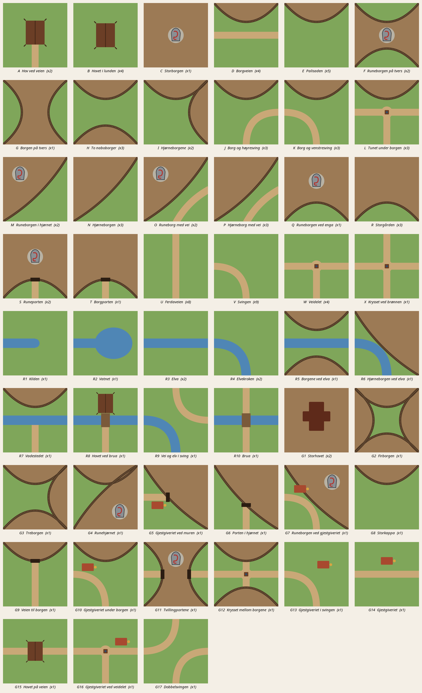

# Karkasand – beskrivelse av brikkene

Dette dokumentet beskriver alle brikkene i Karkasand: hva de skal forestille, hvordan de skal se ut, og de tekniske kravene til bildefilene. Bruk det sammen med skissene i [kunst/skisser/](../kunst/skisser/) når du lager bildene på AI-riggen.



Spillet har **72 brikker** fordelt på **24 brikketyper** (A–X). Du lager **ett bilde per brikketype**. Like brikker bruker samme bilde. For de brikketypene vi har mange av, kan du gjerne lage flere varianter (se [Varianter](#varianter)).

---

## 1. Tekniske krav

| Hva | Krav |
|---|---|
| Format | **JPG**, sRGB |
| Størrelse | **1024 × 1024 piksler**, nøyaktig kvadratisk |
| Kvalitet | JPG-kvalitet 85–92, helst under 400 kB per fil |
| Filnavn | Brikkebokstaven med stor bokstav: `A.jpg`, `B.jpg` … `X.jpg`. Varianter: `U_2.jpg`, `U_3.jpg` |
| Plassering | Legg filene i `kunst/brikker/` |
| Retning | **Nord er øverst**, akkurat som i skissen. Spillet roterer brikkene selv |
| Ramme | **Ingen** ramme, kant, vignett eller avrundede hjørner. Motivet skal gå helt ut til kanten |

> **Viktig:** Bildet må **ikke** speilvendes. J og K, og O/P sammenlignet med M/N, er ulike brikker fordi de er speilbilder av hverandre.

### Perspektiv og lys
- **Rett ovenfra** (ortografisk fugleperspektiv), som et kart. Ingen horisont, ingen himmel og ikke skrått eller isometrisk.
- **Mykt og diffust lys**, som en overskyet nordisk dag. **Ingen tydelige slagskygger i én retning.** Brikkene roteres i spillet, og skygger som peker i ulike retninger ville avsløre det. Bruk heller korte, myke skygger rett under ting (ambient occlusion).
- Hus, trær og folk sees ovenfra: vi ser hustak, trekroner og hoder.

---

## 2. Kantreglene

Når to brikker ligger inntil hverandre, må det ene bildet fortsette sømløst inn i det neste. Derfor har alle brikkene felles mål, oppgitt i piksler på et bilde på 1024 × 1024:

| Element | Regel |
|---|---|
| **Vei** | Treffer kanten **nøyaktig midt på** (512 px). Bredden er **110 px** (fra 457 til 567 px). Den er rett når den krysser kanten. |
| **Borg mot kant** | Borggrunnen dekker **hele kanten**, fra hjørne til hjørne. |
| **Borgkappe** | Når borgen bare dekker én kant, buer palisaden inn til **300 px** fra kanten på midten og ender i de to hjørnene. |
| **Palisade** | Ender alltid **i et hjørne** av brikken, aldri midt på en kant. Den er ca. 36–40 px tykk og står på borgsiden av grensen. |
| **Eng mot kant** | Bare gress. Samme grønnfarge og tetthet langs alle kanter. |
| **Borgfarger** | Bare gråtoner, brunt, hvitt og svart. Ikke noe grønt. |
| **Kantsonen** | Hold de **ytterste 48 px** langs hver kant fri for gjenstander, og vis bare underlaget (gress, vei eller borggrunn). Hus, trær, steiner, folk og dyr skal ikke kuttes av kanten. |

**Underlaget langs kantene må være likt på alle brikkene.** Gresset skal ha samme farge og struktur, veien samme jordfarge med steinheller, og borggrunnen samme trampede jord og plankeganger. Det er dette som får brettet til å se ut som ett sammenhengende landskap.

---

## 3. Bildeelementene

### Eng (gress)
Saftig, litt vill nordisk beitemark: mosegrønt gress med innslag av lyng, blåklokker, smørblomster og små gråsteiner. Inne på brikken, utenfor kantsonen, kan det være enkelte bjørker, einer, en sau, en steingard eller en bekk. Hold det rolig, slik at engen fungerer som bakgrunn.

### Vei (ferdavei)
En opptråkket jordvei i lys brun-oker med hjulspor, små steinheller og gress som vokser inn i kantene. Veien skal ikke ha kantstein eller murer.

### Borg (borggrunn)
Inne i borgen er bakken trampet jord, med plankeganger mellom husene. Der står **langhus med grå spontak** (sett ovenfra, med røykhull), stabbur, smie, tønner, ved og fiskehjeller. Gjerne røyk fra et par røykhull. **Bygninger holdes 48 px unna kantene** som berører andre brikker.

**Ingen grønnfarge i borgen.** Alt innenfor palisaden har bare gråtoner, brunt, hvitt og svart: ingen torvtak, gress, busker eller trær. På en TV-skjerm blir brikkene små, og da er fargen det som skiller borg fra eng. Grønt hører til enga.

### Palisade
En **trepalisade** av tette, tilspissede tømmerstokker i mørk, værbitt brun. Sett ovenfra ser den ut som en tykk rad med stokketopper. Det skal ikke være noen steinmur, for dette er ikke en middelalderborg. Gjerne med små vaktplattformer innimellom.

### Runestein (bonuspoeng)
En reist **grå runestein** med en **rødmalt ormeslynge** (Urnes-stil) inne i borgen. Den gir dobbelt så mange poeng i spillet, så den **må være lett å se**. Den skal fylle ca. 12–15 % av brikkens bredde, ha sterk rødfarge og gjerne et lite steinlagt område rundt seg. Plasseringen er vist i skissen.

### Hov (tilsvarer klosteret)
Et gudehus i tre, sett ovenfra. Det er et rektangulært bygg med bratt tak av spon eller torv, mønekam og **dragehoder på gavlene**. Ved siden av står et hellig tre, gjerne en stor ask, og rundt er det en liten steinsetting og et offeralter (horg). Hovet står midt på brikken og er omgitt av eng.

### Tun (veikryss)
Der veier møtes, står et lite **tun** med en **brønn** midt i krysset (et rundt steinsatt hull med vindestokk), et lite uthus og eventuelt en vognhjulsstabel. Veiene stopper ved tunet.

### Fargepalett (veiledende)
| Element | Farge |
|---|---|
| Gress | mosegrønn `#6f8f4e` til `#7fa65a` |
| Vei | lys oker `#c9a877` |
| Borggrunn | jordbrun `#9c7a55` |
| Palisade | mørk tømmerbrun `#4a3523` |
| Tak i borgen | grå spon og mørkt, værbitt treverk, aldri grønt |
| Runestein | skifergrå `#8a8f94` med rødt `#b3322b` |

Fargene er bare veiledende. Det viktigste er at de er **like på alle brikkene**.

---

## 4. Felles stil (prompt)

Bruk samme stilbeskrivelse på alle brikkene og legg til den brikkespesifikke delen fra kapittel 5. Promptene er på engelsk, fordi de fleste bildemodellene forstår engelsk best.

**Stilprompt (felles):**
```
top-down orthographic bird's-eye view, square board game tile, hand-painted gouache and watercolor illustration, richly detailed, rural Norway in the late 12th century at the end of the Viking Age, muted Nordic palette of moss green, heather purple, birch white, weathered timber brown and slate grey, soft overcast diffuse daylight, no directional cast shadows, painterly brushwork, fills the entire frame edge to edge, consistent grass texture along all edges
```

**Borgprompt (felles):** brukes når borggrunnen males på nytt for seg (se arbeidsflyten under).
```
inside a Norse settlement seen from directly above: bare trampled brown earth ground with no grass and no plants, crowded longhouses with grey wooden shingle roofs and smoke holes, dark weathered timber walls, wooden plank walkways between the houses, a storehouse on posts, barrels, stacked firewood and fish drying racks, only grey, brown, black and white colours, nothing green
```

**Kantkilder (felles):** tre bilder som bare har underlaget. Kantstripen på alle brikkene hentes fra dem. For eng og borg brukes bare midten av bildet, speilet til en sømløs flate.
```
eng: an open Nordic meadow seen from directly above, only grass with a little heather, no trees, no stones, nothing else
borg: bare trampled brown earth ground seen from directly above, a few pebbles and wisps of straw, nothing else
vei: a straight dirt road runs vertically from the exact middle of the top edge to the exact middle of the bottom edge through open meadow, no trees, no stones, nothing else
elv: a river flows straight across the tile from the exact middle of the left edge to the exact middle of the right edge through open meadow, clear blue-grey water, no trees, no stones, nothing else
```

**Negativ prompt (felles):**
```
perspective, isometric, horizon, sky, clouds, text, letters, watermark, signature, border, frame, vignette, rounded corners, drop shadow, stone castle, medieval European castle, knights, modern objects, photorealistic, 3d render, blurry, cropped buildings at edges
```

### Anbefalt arbeidsflyt på AI-riggen
`npm run brikker` gjør alt dette automatisk med Z-Image Turbo i ComfyUI på AI-serveren (se `verktoy/lag-brikker.js`):
- **Runde 1:** Hele brikken males med brikkens prompt. Et kantkart av skissen styrer ControlNet.
- **Runde 2:** Borggrunnen, med runesteinen, klippes ut, skaleres opp og males på nytt med borgprompten. Modellen ser bare strekene i kantkartet og vet ellers ikke hvilken side av palisaden som er borg. Grønt som likevel havner inne i borgen (torvtak, busker), gjøres grått etterpå.
- **Runde 3:** Båndet langs kantene byttes ut med det samme båndet fra tre kildebilder som er malt med kantkilde-promptene: bare eng, bare borggrunn og en rett vei (dreid for øst–vest). Da møtes alle brikkene likt. Kildene ligger i `kunst/teksturer/`. Er du ikke fornøyd med kantene, slett filene der og kjør på nytt med en annen `--seed`.

Slik gjør du det for hånd:
1. Bruk skissen `kunst/skisser/<ID>.png` som **styringsbilde**. Det kan være ControlNet med segmentering, canny eller scribble, eller img2img med denoise på omtrent 0,55–0,75. Skissene er flate og fargekodet: grønn er eng, lys brun er vei, mellombrun er borggrunn, mørk brun stripe er palisade, mørkebrunt rektangel er hov, grå stein med rødt er runestein, og den lille firkanten i en lys sirkel er tun med brønn.
2. Lag med samme oppløsning (1024 × 1024), eller høyere og skaler ned.
3. Bruk gjerne **samme seed og samme innstillinger** for alle brikkene, slik at stilen blir lik.
4. Legg bildene i `kunst/brikker/` og åpne `/galleri` i spillet. Der ser du hvilke brikker som er malt, og et tilfeldig brett der du kan se om kantene passer sammen.

---

## 5. Brikkene én for én

Kanter er oppgitt som **N / Ø / S / V** (nord, øst, sør, vest) slik bildet ligger med nord øverst.

---

### A – Hov ved veien · 2 stk
**Kanter:** eng / eng / vei / eng · **Skisse:** [A.png](../kunst/skisser/A.png)

**Motiv:** Et hov står midt på brikken, litt mot nord, omgitt av eng. En vei kommer inn fra sørkanten og ender ved inngangen på hovets sørgavl. Ved siden av hovet står en stor ask og en liten steinsatt horg.

**Detaljer:** dragehoder på gavlene, offerskål på horgen, noen ravner i asketreet, eng med lyng rundt.

**Prompt:**
```
a wooden Norse pagan temple (hov) with steep shingled roof and carved dragon heads on the gables seen from directly above, centered slightly north, surrounded by meadow, a sacred ash tree and a small stone altar beside it, a dirt road enters from the exact middle of the bottom edge and ends at the temple door
```

---

### B – Hovet i lunden · 4 stk
**Kanter:** eng / eng / eng / eng · **Skisse:** [B.png](../kunst/skisser/B.png)

**Motiv:** Et hov midt på brikken, med eng på alle sider og ingen vei. Det står i en liten lund av bjørk og ask, med en steinsetting rundt.

**Detaljer:** et rundt gjerde av staker med hestehodeskaller, en stor ask og noen bautasteiner. Pass på at trærne holder seg innenfor kantsonen.

**Prompt:**
```
a wooden Norse pagan temple (hov) with dragon-head gables seen from directly above in the exact center, inside a small sacred grove of birch and ash trees, ring of standing stones around it, open meadow on all four sides reaching every edge, no road
```

---

### C – Storborgen · 1 stk
**Kanter:** borg / borg / borg / borg · **Runestein** · **Skisse:** [C.png](../kunst/skisser/C.png)

**Motiv:** Hele brikken er inne i en stor borg. Langhus med grå spontak ligger tett, med plankeganger mellom. Midt på står en stor runestein på en liten steinlagt plass. Det er ingen palisade, fordi borgen fortsetter på alle kanter.

**Detaljer:** røyk fra røykhull, et smiebål, tønner og fiskehjeller. Ingen hus i kantsonen.

**Prompt:**
```
the inside of a large Viking settlement filling the entire tile, longhouses with grey wooden shingle roofs seen from above, wooden plank walkways, packed earth ground reaching all four edges, a prominent grey runestone with a bright red painted serpent knotwork in the exact center on a small stone-paved square, no palisade
```

---

### D – Borgveien · 4 stk (én av dem er startbrikken)
**Kanter:** borg / vei / eng / vei · **Skisse:** [D.png](../kunst/skisser/D.png)

**Motiv:** En borgkappe med palisade i nord. En rett vei går tvers over brikken fra vest til øst, midt på. Det er eng mellom palisaden og veien og sør for veien.

**Detaljer:** taket på et langhus innenfor palisaden, en reisende med vandrestav på veien og en ku i enga sør for veien.

**Prompt:**
```
top edge: a curved wooden palisade of sharpened logs enclosing part of a Viking settlement with a longhouse with a grey wooden shingle roof, the palisade arcs from the top-left corner to the top-right corner reaching 30% down at its middle; a straight dirt road crosses the tile horizontally from the middle of the left edge to the middle of the right edge; meadow elsewhere
```

---

### E – Palisaden · 5 stk
**Kanter:** borg / eng / eng / eng · **Skisse:** [E.png](../kunst/skisser/E.png)

**Motiv:** En borgkappe med palisade i nord og eng på resten av brikken.

**Detaljer:** bak palisaden et stabbur og en vaktplattform. I enga noen sauer og en steingard. Lag gjerne 2 varianter.

**Prompt:**
```
top edge: a curved wooden palisade of sharpened logs enclosing part of a Viking settlement with grey shingle roofs, arcing from the top-left corner to the top-right corner and reaching 30% down at its middle; the rest of the tile is open meadow with heather, a few sheep and a low stone wall
```

---

### F – Runeborgen på tvers · 2 stk
**Kanter:** eng / borg / eng / borg · **Runestein** · **Skisse:** [F.png](../kunst/skisser/F.png)

**Motiv:** Borgen går tvers over brikken fra vest til øst og smalner av på midten. Mot nord og sør buer palisaden inn, med eng utenfor. En runestein står midt i borgen.

**Detaljer:** én lang gate av planker gjennom borgen, langhus på begge sider og en runestein på en liten plass.

**Prompt:**
```
a Viking settlement band running from the left edge to the right edge, narrowing in the middle, two curved wooden palisades: one arcing between the top corners, one arcing between the bottom corners, meadow outside both palisades at top and bottom, longhouses with grey wooden shingle roofs and a plank street inside, a prominent grey runestone with bright red serpent knotwork in the center
```

---

### G – Borgen på tvers · 1 stk
**Kanter:** borg / eng / borg / eng · **Skisse:** [G.png](../kunst/skisser/G.png)

**Motiv:** Samme form som F, men borgen går fra nord til sør, og det er ingen runestein. Palisadene buer inn fra øst og vest, med eng utenfor.

**Prompt:**
```
a Viking settlement band running from the top edge to the bottom edge, narrowing in the middle, two curved wooden palisades: one arcing between the two left corners, one between the two right corners, meadow outside both palisades at left and right, longhouses with grey wooden shingle roofs and a plank street inside, no runestone
```

---

### H – To naboborger · 3 stk
**Kanter:** borg / eng / borg / eng · **To adskilte borger** · **Skisse:** [H.png](../kunst/skisser/H.png)

**Motiv:** Én borgkappe i nord og én i sør, hver med sin egen palisade. Mellom dem ligger et belte med eng fra vest til øst. De to borgene henger **ikke** sammen.

**Detaljer:** i enga mellom borgene en liten bekk eller et jorde med korn.

**Prompt:**
```
two separate Viking settlements: one behind a curved wooden palisade at the top edge arcing between the top corners, one behind a curved palisade at the bottom edge arcing between the bottom corners, each reaching 30% into the tile; a band of open meadow with a small field of barley between them from left edge to right edge
```

---

### I – Hjørneborgene · 2 stk
**Kanter:** borg / borg / eng / eng · **To adskilte borger** · **Skisse:** [I.png](../kunst/skisser/I.png)

**Motiv:** Én borgkappe i nord og én i øst. Hver har sin egen palisade, og de møtes i det nordøstlige hjørnet uten å henge sammen. Resten er eng.

**Detaljer:** der palisadene møtes i hjørnet, skal det tydelig se ut som to separate gjerder.

**Prompt:**
```
two separate Viking settlements each behind its own curved wooden palisade: one along the top edge arcing between the top corners, one along the right edge arcing between the right corners, the two palisades meet at the top-right corner but the settlements are separate; the rest is open meadow
```

---

### J – Borg og høyresving · 3 stk
**Kanter:** borg / vei / vei / eng · **Skisse:** [J.png](../kunst/skisser/J.png)

**Motiv:** En borgkappe i nord. En vei kommer inn fra midten av østkanten, svinger mykt og går ut midt på sørkanten. Svingen ligger i sørøst. Resten er eng.

> **Ikke speilvend.** K er speilbildet av J.

**Prompt:**
```
top edge: curved wooden palisade of a Viking settlement arcing between the top corners; a dirt road enters at the exact middle of the right edge, curves smoothly and exits at the exact middle of the bottom edge; meadow elsewhere
```

---

### K – Borg og venstresving · 3 stk
**Kanter:** borg / eng / vei / vei · **Skisse:** [K.png](../kunst/skisser/K.png)

**Motiv:** En borgkappe i nord. En vei kommer inn fra midten av vestkanten, svinger mykt og går ut midt på sørkanten. Svingen ligger i sørvest.

**Prompt:**
```
top edge: curved wooden palisade of a Viking settlement arcing between the top corners; a dirt road enters at the exact middle of the left edge, curves smoothly and exits at the exact middle of the bottom edge; meadow elsewhere
```

---

### L – Tunet under borgen · 3 stk
**Kanter:** borg / vei / vei / vei · **Skisse:** [L.png](../kunst/skisser/L.png)

**Motiv:** En borgkappe i nord. Tre veier fra øst, sør og vest møtes i et tun med brønn midt på brikken.

**Detaljer:** brønn med vindestokk, et lite uthus og en kjerre.

**Prompt:**
```
top edge: curved wooden palisade of a Viking settlement arcing between the top corners; three dirt roads from the exact middles of the left, right and bottom edges meet at a small farmyard with a stone well in the center of the tile; meadow between the roads
```

---

### M – Runeborgen i hjørnet · 2 stk
**Kanter:** borg / eng / eng / borg · **Runestein** · **Skisse:** [M.png](../kunst/skisser/M.png)

**Motiv:** Borgen dekker den nordvestlige halvdelen. Palisaden buer fra det nordøstlige til det sørvestlige hjørnet og bukter seg litt ut mot sørøst. Runesteinen står i nordvest. Det er eng i sørøst.

**Prompt:**
```
a Viking settlement fills the upper-left half of the tile, bounded by a curved wooden palisade running from the top-right corner to the bottom-left corner bulging slightly toward the lower right; longhouses with grey wooden shingle roofs inside; a prominent grey runestone with bright red serpent knotwork in the upper-left area; open meadow in the lower-right half
```

---

### N – Hjørneborgen · 3 stk
**Kanter:** borg / eng / eng / borg · **Skisse:** [N.png](../kunst/skisser/N.png)

**Motiv:** Samme som M, men uten runestein.

**Prompt:**
```
a Viking settlement fills the upper-left half of the tile, bounded by a curved wooden palisade running from the top-right corner to the bottom-left corner bulging slightly toward the lower right; longhouses with grey wooden shingle roofs inside; open meadow in the lower-right half, no runestone
```

---

### O – Runeborg med vei · 2 stk
**Kanter:** borg / vei / vei / borg · **Runestein** · **Skisse:** [O.png](../kunst/skisser/O.png)

**Motiv:** Som M, men en vei går i bue gjennom engen i sørøst, fra midten av østkanten til midten av sørkanten.

**Prompt:**
```
a Viking settlement fills the upper-left half, bounded by a curved wooden palisade from the top-right corner to the bottom-left corner; a prominent grey runestone with bright red serpent knotwork in the upper-left; in the lower-right meadow a dirt road curves from the exact middle of the right edge to the exact middle of the bottom edge
```

---

### P – Hjørneborg med vei · 3 stk
**Kanter:** borg / vei / vei / borg · **Skisse:** [P.png](../kunst/skisser/P.png)

**Motiv:** Samme som O, men uten runestein.

**Prompt:**
```
a Viking settlement fills the upper-left half, bounded by a curved wooden palisade from the top-right corner to the bottom-left corner; in the lower-right meadow a dirt road curves from the exact middle of the right edge to the exact middle of the bottom edge; no runestone
```

---

### Q – Runeborgen ved enga · 1 stk
**Kanter:** borg / borg / eng / borg · **Runestein** · **Skisse:** [Q.png](../kunst/skisser/Q.png)

**Motiv:** Borgen dekker nord, øst og vest. Mot sør buer palisaden inn mellom de to sørlige hjørnene, med eng utenfor. Runesteinen står midt i borgen.

**Prompt:**
```
a Viking settlement covers the tile and reaches the top, left and right edges; along the bottom a curved wooden palisade arcs between the two bottom corners reaching 30% up at its middle, with meadow outside it; longhouses with grey wooden shingle roofs; a prominent grey runestone with bright red serpent knotwork near the center
```

---

### R – Storgården · 3 stk
**Kanter:** borg / borg / eng / borg · **Skisse:** [R.png](../kunst/skisser/R.png)

**Motiv:** Samme som Q, men uten runestein. Gjerne med et stort høvdingehus i midten.

**Prompt:**
```
a Viking settlement covers the tile and reaches the top, left and right edges; along the bottom a curved wooden palisade arcs between the two bottom corners with meadow outside it; a large chieftain's longhouse in the middle, no runestone
```

---

### S – Runeporten · 2 stk
**Kanter:** borg / borg / vei / borg · **Runestein** · **Skisse:** [S.png](../kunst/skisser/S.png)

**Motiv:** Som Q, men en vei kommer inn midt på sørkanten og går gjennom en **port i palisaden** og inn i borgen. Runesteinen står like innenfor porten.

**Prompt:**
```
a Viking settlement covers the tile reaching the top, left and right edges; along the bottom a curved wooden palisade arcs between the bottom corners; a dirt road enters at the exact middle of the bottom edge and passes through a wooden gate in the palisade into the settlement; a prominent grey runestone with bright red serpent knotwork just inside the gate
```

---

### T – Borgporten · 1 stk
**Kanter:** borg / borg / vei / borg · **Skisse:** [T.png](../kunst/skisser/T.png)

**Motiv:** Samme som S, men uten runestein.

**Prompt:**
```
a Viking settlement covers the tile reaching the top, left and right edges; along the bottom a curved wooden palisade arcs between the bottom corners; a dirt road enters at the exact middle of the bottom edge and passes through a wooden gate in the palisade; no runestone
```

---

### U – Ferdaveien · 8 stk
**Kanter:** vei / eng / vei / eng · **Skisse:** [U.png](../kunst/skisser/U.png)

**Motiv:** En rett vei fra midten av nordkanten til midten av sørkanten, med eng på begge sider.

**Detaljer:** Dette er en vanlig brikke, så lag gjerne **3 varianter**. Variant 1 kan ha en hest og kjerre, variant 2 en bautastein ved veien og et par bjørker, og variant 3 en bekk under ei lita trebru.

**Prompt:**
```
a straight dirt road runs vertically from the exact middle of the top edge to the exact middle of the bottom edge, open Nordic meadow with heather and wildflowers on both sides
```

---

### V – Svingen · 9 stk
**Kanter:** eng / eng / vei / vei · **Skisse:** [V.png](../kunst/skisser/V.png)

**Motiv:** En vei kommer inn midt på vestkanten, svinger og går ut midt på sørkanten. Resten er eng.

**Detaljer:** Dette er den vanligste brikken, så lag gjerne **3 varianter**: en stor stein i svingen, en einerbusk og en geit, eller et lite potetjorde.

**Prompt:**
```
a dirt road enters at the exact middle of the left edge, curves smoothly and exits at the exact middle of the bottom edge; open Nordic meadow elsewhere with a large boulder inside the curve
```

---

### W – Veidelet · 4 stk
**Kanter:** eng / vei / vei / vei · **Skisse:** [W.png](../kunst/skisser/W.png)

**Motiv:** Tre veier fra øst, sør og vest møtes i et tun med brønn midt på brikken. Nord for tunet er det eng.

**Prompt:**
```
a T-shaped road junction: one dirt road runs straight across the tile from the middle of the left edge to the middle of the right edge, and a second dirt road comes up from the middle of the bottom edge and ends at a small farmyard with a stone well in the center; no road goes north, the whole upper half is unbroken open meadow with a small storehouse
```

---

### X – Krysset ved brønnen · 1 stk
**Kanter:** vei / vei / vei / vei · **Skisse:** [X.png](../kunst/skisser/X.png)

**Motiv:** Fire veier, én fra midten av hver kant, møtes ved en brønn midt på brikken. Det er eng i de fire hjørnene.

**Prompt:**
```
four dirt roads from the exact middles of all four edges meet at a stone well in the center of the tile, a small farmyard around the well, open meadow in the four corners
```

---

---

## Utvidelsene

Brikkene fra utvidelsene følger de samme reglene og den samme stilen som grunnspillet. Filene heter `R1.jpg` til `R10.jpg` (Elva), `G1.jpg` til `G17.jpg` (Gjestgiveri og storhov) og `H1.jpg` til `H14.jpg` (Handel og håndverk).

- **Elv** treffer kanten **nøyaktig midt på**, akkurat som en vei, men er **150 px** bred (fra 437 til 587 px). Vannet er klart og blågrått, med siv og steiner langs breddene. Elva er ikke et område man kan sette vikinger i, og den deler enga i to.
- **Gjestgiveri** er et lite hus ved veien, med et utskåret mjødskilt, tønner og benker. Det må synes godt, fordi det endrer poengene for veien.
- **Storhov** er et stort gudehus midt i en borg, med takene i flere lag og dragehoder, i samme stil som hovet, men større.

### R1 – Kilden · 1 stk
**Kanter:** eng / eng / eng / elv · **Skisse:** [R1.png](../kunst/skisser/R1.png)

**Motiv:** Startbrikken når Elva er med. En kilde vokser fram mellom mosegrodde steiner midt på brikken, og elva renner ut midt på vestkanten.

**Prompt:**
```
a round spring pool ringed by mossy stones in the exact center of the tile; from the pool a river flows straight to the left, horizontally, and leaves through the exact middle of the left edge; the river runs only between the center and the left edge; the right half, top and bottom of the tile are open Nordic meadow with heather
```

### R2 – Vatnet · 1 stk
**Kanter:** eng / eng / eng / elv · **Skisse:** [R2.png](../kunst/skisser/R2.png)

**Motiv:** Elva kommer inn fra vest og renner ut i et stille vatn. Siste elvebrikke.

**Prompt:**
```
a river enters at the exact middle of the left edge and flows into a large calm lake in the center-right of the tile, reeds along the shore and a small wooden boat pulled up on the bank; meadow around the lake
```

### R3 – Elva · 2 stk
**Kanter:** eng / elv / eng / elv · **Skisse:** [R3.png](../kunst/skisser/R3.png)

**Motiv:** Elva renner rett tvers over brikken fra vest til øst.

**Prompt:**
```
a river flows straight across the tile from the exact middle of the left edge to the exact middle of the right edge, open meadow on both banks with a few reeds and stones
```

### R4 – Elvekroken · 2 stk
**Kanter:** eng / eng / elv / elv · **Skisse:** [R4.png](../kunst/skisser/R4.png)

**Motiv:** Elva kommer inn fra vest og svinger ut mot sør.

**Prompt:**
```
a river enters at the exact middle of the left edge, curves smoothly and leaves at the exact middle of the bottom edge; open meadow elsewhere
```

### R5 – Borgene ved elva · 1 stk
**Kanter:** borg / elv / borg / elv · **Skisse:** [R5.png](../kunst/skisser/R5.png)

**Motiv:** To adskilte borgkapper i nord og sør, med elva mellom seg.

**Prompt:**
```
two separate Viking settlements behind curved wooden palisades, one along the top edge arcing between the top corners and one along the bottom edge arcing between the bottom corners; a river flows straight across the middle from the left edge to the right edge between them
```

### R6 – Hjørneborgen ved elva · 1 stk
**Kanter:** borg / borg / elv / elv · **Skisse:** [R6.png](../kunst/skisser/R6.png)

**Motiv:** Borgen dekker den nordøstlige halvdelen. Elva svinger gjennom det sørvestlige hjørnet.

**Prompt:**
```
a Viking settlement fills the upper-right half of the tile behind a curved wooden palisade running from the top-left corner to the bottom-right corner; in the lower-left a river enters at the middle of the left edge, curves and leaves at the middle of the bottom edge; meadow between the palisade and the river
```

### R7 – Vadestedet · 1 stk
**Kanter:** borg / elv / vei / elv · **Skisse:** [R7.png](../kunst/skisser/R7.png)

**Motiv:** En borgkappe i nord, elva tvers over brikken, og en vei fra sør som ender ved et vadested.

**Prompt:**
```
top edge: curved wooden palisade of a Viking settlement arcing between the top corners; a river flows straight across the middle from the left edge to the right edge; a dirt road comes up from the exact middle of the bottom edge and ends at a shallow ford on the river bank
```

### R8 – Hovet ved brua · 1 stk
**Kanter:** eng / elv / vei / elv · **Skisse:** [R8.png](../kunst/skisser/R8.png)

**Motiv:** Et lite hov nord for elva. En vei fra sør krysser elva på ei bru og ender ved hovet.

**Prompt:**
```
a small wooden Norse temple (hov) with dragon-head gables in the upper middle of the tile; a river flows straight across the middle from the left edge to the right edge; a dirt road comes from the exact middle of the bottom edge, crosses the river on a wooden plank bridge and ends at the temple door
```

### R9 – Vei og elv i sving · 1 stk
**Kanter:** vei / vei / elv / elv · **Skisse:** [R9.png](../kunst/skisser/R9.png)

**Motiv:** En veisving i nordøst og en elvesving i sørvest. De møtes ikke.

**Prompt:**
```
a dirt road enters at the exact middle of the top edge, curves and leaves at the exact middle of the right edge; a river enters at the exact middle of the left edge, curves and leaves at the exact middle of the bottom edge; the two curves do not touch, meadow between them
```

### R10 – Brua · 1 stk
**Kanter:** vei / elv / vei / elv · **Skisse:** [R10.png](../kunst/skisser/R10.png)

**Motiv:** Elva renner fra vest til øst, og veien går over den på ei solid trebru.

**Prompt:**
```
a river flows straight across the middle from the left edge to the right edge; a dirt road runs straight from the exact middle of the top edge to the exact middle of the bottom edge and crosses the river on a sturdy wooden bridge
```

### G1 – Storhovet · 2 stk
**Kanter:** borg / borg / borg / borg · **Skisse:** [G1.png](../kunst/skisser/G1.png)

**Motiv:** Midt inne i en stor borg står et storhov, et stort gudehus med takene i flere lag og dragehoder. Ingen palisade.

**Prompt:**
```
the inside of a large Viking settlement filling the entire tile, a great stave-church-like temple hall with tiered shingled roofs and carved dragon heads stands in the center, longhouses with grey wooden shingle roofs around it, packed earth ground reaching all four edges, no palisade
```

### G2 – Firborgen · 1 stk
**Kanter:** borg / borg / borg / borg · **Skisse:** [G2.png](../kunst/skisser/G2.png)

**Motiv:** Fire små borger, én langs hver kant, som ikke henger sammen. Eng i midten.

**Prompt:**
```
four small separate Viking settlements, one at each edge, each behind its own curved wooden palisade arcing between the corners of that edge; an open meadow in the center of the tile between the four palisades with a few sheep
```

### G3 – Treborgen · 1 stk
**Kanter:** borg / borg / borg / eng · **Skisse:** [G3.png](../kunst/skisser/G3.png)

**Motiv:** Tre små borger i nord, øst og sør, hver for seg. Enga når vestkanten.

**Prompt:**
```
three small separate Viking settlements at the top, right and bottom edges, each behind its own curved wooden palisade arcing between the corners of its edge; open meadow in the middle reaching the left edge
```

### G4 – Runehjørnet · 1 stk
**Kanter:** borg / borg / borg / eng · **Skisse:** [G4.png](../kunst/skisser/G4.png)

**Motiv:** En liten borgkappe i nord og en større borg med runestein i sørøst. De henger ikke sammen.

**Prompt:**
```
a curved wooden palisade of a small settlement along the top edge arcing between the top corners; a larger Viking settlement fills the lower-right half behind a curved palisade running from the top-right corner to the bottom-left corner, with a prominent grey runestone with bright red serpent knotwork; meadow on the left
```

### G5 – Gjestgiveriet ved muren · 1 stk
**Kanter:** borg / borg / eng / vei · **Skisse:** [G5.png](../kunst/skisser/G5.png)

**Motiv:** Borgen dekker nordøst. En vei fra vest ender ved en port, og ved veien ligger et gjestgiveri.

**Prompt:**
```
a Viking settlement fills the upper-right half of the tile behind a curved wooden palisade from the top-left corner to the bottom-right corner; a dirt road comes from the exact middle of the left edge and ends at a gate in the palisade; beside the road a small log-built Viking mead-hall inn with a green turf roof and a carved wooden mead-horn sign and barrels; meadow elsewhere
```

### G6 – Porten i hjørnet · 1 stk
**Kanter:** borg / borg / vei / eng · **Skisse:** [G6.png](../kunst/skisser/G6.png)

**Motiv:** Borgen dekker nordøst. En vei fra sør ender ved en port.

**Prompt:**
```
a Viking settlement fills the upper-right half of the tile behind a curved wooden palisade from the top-left corner to the bottom-right corner; a dirt road comes up from the exact middle of the bottom edge and ends at a gate in the palisade; meadow elsewhere
```

### G7 – Runeborgen ved gjestgiveriet · 1 stk
**Kanter:** borg / borg / vei / vei · **Skisse:** [G7.png](../kunst/skisser/G7.png)

**Motiv:** Borgen med runestein dekker nordøst. En vei svinger fra vest til sør, med et gjestgiveri ved veien.

**Prompt:**
```
a Viking settlement fills the upper-right half behind a curved wooden palisade from the top-left corner to the bottom-right corner, with a prominent grey runestone with bright red serpent knotwork; a dirt road enters at the exact middle of the left edge, curves and exits at the exact middle of the bottom edge; beside the road a small log-built Viking mead-hall inn with a green turf roof and a carved wooden mead-horn sign and barrels
```

### G8 – Storkappa · 1 stk
**Kanter:** borg / eng / eng / eng · **Skisse:** [G8.png](../kunst/skisser/G8.png)

**Motiv:** En dyp borgkappe i nord, og eng på resten av brikken.

**Prompt:**
```
top edge: a deep curved wooden palisade of a Viking settlement arcing from the top-left corner to the top-right corner; the rest is open meadow with sheep
```

### G9 – Veien til borgen · 1 stk
**Kanter:** borg / eng / vei / eng · **Skisse:** [G9.png](../kunst/skisser/G9.png)

**Motiv:** En borgkappe i nord. En rett vei fra sør ender ved porten.

**Prompt:**
```
top edge: curved wooden palisade of a Viking settlement arcing between the top corners; a dirt road comes from the exact middle of the bottom edge straight up to a wooden gate in the palisade; meadow on both sides of the road
```

### G10 – Gjestgiveriet under borgen · 1 stk
**Kanter:** borg / eng / vei / vei · **Skisse:** [G10.png](../kunst/skisser/G10.png)

**Motiv:** En borgkappe i nord og en vei som svinger fra vest til sør, med et gjestgiveri ved veien.

**Prompt:**
```
top edge: curved wooden palisade of a Viking settlement arcing between the top corners; a dirt road enters at the exact middle of the left edge, curves and exits at the exact middle of the bottom edge; beside the road a small log-built Viking mead-hall inn with a green turf roof and a carved wooden mead-horn sign and barrels
```

### G11 – Tvillingportene · 1 stk
**Kanter:** borg / vei / borg / vei · **Skisse:** [G11.png](../kunst/skisser/G11.png)

**Motiv:** En borg går fra nord til sør. To veier fra vest og øst ender ved hver sin port. Runestein i borgen.

**Prompt:**
```
a Viking settlement band running from the top edge to the bottom edge, with two curved wooden palisades arcing between the two left corners and between the two right corners; two dirt roads come from the exact middles of the left and right edges and end at wooden gates in the palisades; a prominent grey runestone with bright red serpent knotwork in the settlement; meadow outside the palisades
```

### G12 – Krysset mellom borgene · 1 stk
**Kanter:** borg / vei / borg / vei · **Skisse:** [G12.png](../kunst/skisser/G12.png)

**Motiv:** To borgkapper i nord og sør. Veier fra vest og øst og stier fra begge borgene møtes ved en brønn.

**Prompt:**
```
two separate Viking settlements behind curved wooden palisades at the top edge and the bottom edge; two dirt roads from the exact middles of the left and right edges and short paths from both settlements meet at a small farmyard with a stone well in the center
```

### G13 – Gjestgiveriet i svingen · 1 stk
**Kanter:** eng / eng / vei / vei · **Skisse:** [G13.png](../kunst/skisser/G13.png)

**Motiv:** En vei svinger fra vest til sør, med et gjestgiveri ved veien.

**Prompt:**
```
a dirt road enters at the exact middle of the left edge, curves and exits at the exact middle of the bottom edge; outside the curve a small log-built Viking mead-hall inn with a green turf roof and a carved wooden mead-horn sign, barrels and a hitching post; open meadow elsewhere
```

### G14 – Gjestgiveriet · 1 stk
**Kanter:** eng / vei / eng / vei · **Skisse:** [G14.png](../kunst/skisser/G14.png)

**Motiv:** En rett vei fra vest til øst, med et gjestgiveri på nordsiden.

**Prompt:**
```
a straight dirt road runs from the exact middle of the left edge to the exact middle of the right edge; on the upper side of the road a small log-built Viking mead-hall inn with a green turf roof and a carved wooden mead-horn sign, barrels and benches; meadow elsewhere
```

### G15 – Hovet på veien · 1 stk
**Kanter:** eng / vei / eng / vei · **Skisse:** [G15.png](../kunst/skisser/G15.png)

**Motiv:** Et lite hov midt på brikken. Veiene fra vest og øst ender ved hovet.

**Prompt:**
```
a small wooden Norse temple (hov) with dragon-head gables in the center of the tile; two dirt roads come from the exact middles of the left and right edges and end at the temple; open meadow above and below
```

### G16 – Gjestgiveriet ved veidelet · 1 stk
**Kanter:** eng / vei / vei / vei · **Skisse:** [G16.png](../kunst/skisser/G16.png)

**Motiv:** Et T-kryss med brønn, og et gjestgiveri ved veien mot øst.

**Prompt:**
```
a T-shaped road junction: one dirt road runs straight across the tile from the middle of the left edge to the middle of the right edge, and a second dirt road comes up from the middle of the bottom edge and ends at a small farmyard with a stone well in the center; beside the right-hand road a small log-built Viking mead-hall inn with a green turf roof and a carved wooden mead-horn sign; no road goes north, the whole upper half is unbroken open meadow
```

### G17 – Dobbelsvingen · 1 stk
**Kanter:** vei / vei / vei / vei · **Skisse:** [G17.png](../kunst/skisser/G17.png)

**Motiv:** To veisvinger som ikke møtes: fra nord til vest og fra øst til sør.

**Prompt:**
```
two separate dirt road curves: one enters at the exact middle of the top edge and curves to the exact middle of the left edge, the other enters at the exact middle of the right edge and curves to the exact middle of the bottom edge; they do not touch, a meadow band between them
```

## Handel og håndverk

Brikkene `H1.jpg` til `H14.jpg` har **nøyaktig samme form** som en brikke i grunnspillet (se «Form» under hver brikke). Promptene under er prompten til den brikken, med varen lagt til. `npm run brikker` maler likevel hele brikken med grunnbrikkens prompt og seed, og legger varen til først når borgen males på nytt. Ellers maler modellen en ekstra innhegning med varen ute i enga. Skissen er den samme som for grunnbrikken. Varen må synes godt inne i borgen, fordi den gir poeng:

- **Tørrfisk:** noen tørrfisker som henger parvis på en liten hjell.
- **Jern:** en liten smie med glør i essa og en stabel mørke jernbarrer.
- **Korn:** et lite stabbur med gylne kornband lent mot veggen.

Ikke ha med høna eller byggmesteren på brikkene. De er figurer som spillerne setter ut.

### H1 – Fiskebua · 2 stk
**Kanter:** borg / eng / eng / eng · **Form:** som E · **Skisse:** [H1.png](../kunst/skisser/H1.png)

**Motiv:** Samme som E, med tørrfisk på en liten hjell inne i borgen.

**Prompt:**
```
top edge: a curved wooden palisade of sharpened logs enclosing part of a Viking settlement with grey shingle roofs, arcing from the top-left corner to the top-right corner and reaching 30% down at its middle; the rest of the tile is open meadow with heather, a few sheep and a low stone wall; inside the walled settlement: a large wooden drying rack (hjell) full of pale dried stockfish hanging in rows, clearly visible in the open yard
```

### H2 – Smia · 1 stk
**Kanter:** borg / eng / eng / eng · **Form:** som E · **Skisse:** [H2.png](../kunst/skisser/H2.png)

**Motiv:** Samme som E, med en liten smie med en stabel jernbarrer inne i borgen.

**Prompt:**
```
top edge: a curved wooden palisade of sharpened logs enclosing part of a Viking settlement with grey shingle roofs, arcing from the top-left corner to the top-right corner and reaching 30% down at its middle; the rest of the tile is open meadow with heather, a few sheep and a low stone wall; inside the walled settlement: an open blacksmith forge with a glowing fire, an anvil and a big stack of dark iron bars, clearly visible in the open yard
```

### H3 – Kornloftet · 1 stk
**Kanter:** borg / eng / eng / eng · **Form:** som E · **Skisse:** [H3.png](../kunst/skisser/H3.png)

**Motiv:** Samme som E, med et lite stabbur med kornband inne i borgen.

**Prompt:**
```
top edge: a curved wooden palisade of sharpened logs enclosing part of a Viking settlement with grey shingle roofs, arcing from the top-left corner to the top-right corner and reaching 30% down at its middle; the rest of the tile is open meadow with heather, a few sheep and a low stone wall; inside the walled settlement: a wooden grain store (stabbur) on stone posts with many golden sheaves of grain stacked in front of it, clearly visible in the open yard
```

### H4 – Fiskeveien · 1 stk
**Kanter:** borg / vei / eng / vei · **Form:** som D · **Skisse:** [H4.png](../kunst/skisser/H4.png)

**Motiv:** Samme som D, med tørrfisk på en liten hjell inne i borgen.

**Prompt:**
```
top edge: a curved wooden palisade of sharpened logs enclosing part of a Viking settlement with a longhouse with a grey wooden shingle roof, the palisade arcs from the top-left corner to the top-right corner reaching 30% down at its middle; a straight dirt road crosses the tile horizontally from the middle of the left edge to the middle of the right edge; meadow elsewhere; inside the walled settlement: a large wooden drying rack (hjell) full of pale dried stockfish hanging in rows, clearly visible in the open yard
```

### H5 – Smia ved veien · 1 stk
**Kanter:** borg / vei / eng / vei · **Form:** som D · **Skisse:** [H5.png](../kunst/skisser/H5.png)

**Motiv:** Samme som D, med en liten smie med en stabel jernbarrer inne i borgen.

**Prompt:**
```
top edge: a curved wooden palisade of sharpened logs enclosing part of a Viking settlement with a longhouse with a grey wooden shingle roof, the palisade arcs from the top-left corner to the top-right corner reaching 30% down at its middle; a straight dirt road crosses the tile horizontally from the middle of the left edge to the middle of the right edge; meadow elsewhere; inside the walled settlement: an open blacksmith forge with a glowing fire, an anvil and a big stack of dark iron bars, clearly visible in the open yard
```

### H6 – Kornloftet ved svingen · 1 stk
**Kanter:** borg / vei / vei / eng · **Form:** som J · **Skisse:** [H6.png](../kunst/skisser/H6.png)

**Motiv:** Samme som J, med et lite stabbur med kornband inne i borgen.

**Prompt:**
```
top edge: curved wooden palisade of a Viking settlement arcing between the top corners; a dirt road enters at the exact middle of the right edge, curves smoothly and exits at the exact middle of the bottom edge; meadow elsewhere; inside the walled settlement: a wooden grain store (stabbur) on stone posts with many golden sheaves of grain stacked in front of it, clearly visible in the open yard
```

### H7 – Jernsvingen · 1 stk
**Kanter:** borg / vei / vei / eng · **Form:** som J · **Skisse:** [H7.png](../kunst/skisser/H7.png)

**Motiv:** Samme som J, med en liten smie med en stabel jernbarrer inne i borgen.

**Prompt:**
```
top edge: curved wooden palisade of a Viking settlement arcing between the top corners; a dirt road enters at the exact middle of the right edge, curves smoothly and exits at the exact middle of the bottom edge; meadow elsewhere; inside the walled settlement: an open blacksmith forge with a glowing fire, an anvil and a big stack of dark iron bars, clearly visible in the open yard
```

### H8 – Fiskesvingen · 1 stk
**Kanter:** borg / eng / vei / vei · **Form:** som K · **Skisse:** [H8.png](../kunst/skisser/H8.png)

**Motiv:** Samme som K, med tørrfisk på en liten hjell inne i borgen.

**Prompt:**
```
top edge: curved wooden palisade of a Viking settlement arcing between the top corners; a dirt road enters at the exact middle of the left edge, curves smoothly and exits at the exact middle of the bottom edge; meadow elsewhere; inside the walled settlement: a large wooden drying rack (hjell) full of pale dried stockfish hanging in rows, clearly visible in the open yard
```

### H9 – Hjørnesmia · 1 stk
**Kanter:** borg / eng / eng / borg · **Form:** som N · **Skisse:** [H9.png](../kunst/skisser/H9.png)

**Motiv:** Samme som N, med en liten smie med en stabel jernbarrer inne i borgen.

**Prompt:**
```
a Viking settlement fills the upper-left half of the tile, bounded by a curved wooden palisade running from the top-right corner to the bottom-left corner bulging slightly toward the lower right; longhouses with grey wooden shingle roofs inside; open meadow in the lower-right half, no runestone; inside the walled settlement: an open blacksmith forge with a glowing fire, an anvil and a big stack of dark iron bars, clearly visible in the open yard
```

### H10 – Kornhjørnet · 1 stk
**Kanter:** borg / vei / vei / borg · **Form:** som P · **Skisse:** [H10.png](../kunst/skisser/H10.png)

**Motiv:** Samme som P, med et lite stabbur med kornband inne i borgen.

**Prompt:**
```
a Viking settlement fills the upper-left half, bounded by a curved wooden palisade from the top-right corner to the bottom-left corner; in the lower-right meadow a dirt road curves from the exact middle of the right edge to the exact middle of the bottom edge; no runestone; inside the walled settlement: a wooden grain store (stabbur) on stone posts with many golden sheaves of grain stacked in front of it, clearly visible in the open yard
```

### H11 – Fiskegården · 1 stk
**Kanter:** borg / borg / eng / borg · **Form:** som R · **Skisse:** [H11.png](../kunst/skisser/H11.png)

**Motiv:** Samme som R, med tørrfisk på en liten hjell inne i borgen.

**Prompt:**
```
a Viking settlement covers the tile and reaches the top, left and right edges; along the bottom a curved wooden palisade arcs between the two bottom corners with meadow outside it; a large chieftain's longhouse in the middle, no runestone; inside the walled settlement: a large wooden drying rack (hjell) full of pale dried stockfish hanging in rows, clearly visible in the open yard
```

### H12 – Korngården · 1 stk
**Kanter:** borg / borg / eng / borg · **Form:** som R · **Skisse:** [H12.png](../kunst/skisser/H12.png)

**Motiv:** Samme som R, med et lite stabbur med kornband inne i borgen.

**Prompt:**
```
a Viking settlement covers the tile and reaches the top, left and right edges; along the bottom a curved wooden palisade arcs between the two bottom corners with meadow outside it; a large chieftain's longhouse in the middle, no runestone; inside the walled settlement: a wooden grain store (stabbur) on stone posts with many golden sheaves of grain stacked in front of it, clearly visible in the open yard
```

### H13 – Smieporten · 1 stk
**Kanter:** borg / borg / vei / borg · **Form:** som T · **Skisse:** [H13.png](../kunst/skisser/H13.png)

**Motiv:** Samme som T, med en liten smie med en stabel jernbarrer inne i borgen.

**Prompt:**
```
a Viking settlement covers the tile reaching the top, left and right edges; along the bottom a curved wooden palisade arcs between the bottom corners; a dirt road enters at the exact middle of the bottom edge and passes through a wooden gate in the palisade; no runestone; inside the walled settlement: an open blacksmith forge with a glowing fire, an anvil and a big stack of dark iron bars, clearly visible in the open yard
```

### H14 – Fisk og korn · 1 stk
**Kanter:** borg / eng / borg / eng · **Form:** som H · **Skisse:** [H14.png](../kunst/skisser/H14.png)

**Motiv:** Samme som H, med tørrfisk på en liten hjell og et lite stabbur med kornband inne i borgen (tørrfisk i den nordre borgen, korn i den søndre).

**Prompt:**
```
two separate Viking settlements: one behind a curved wooden palisade at the top edge arcing between the top corners, one behind a curved palisade at the bottom edge arcing between the bottom corners, each reaching 30% into the tile; a band of open meadow with a small field of barley between them from left edge to right edge; inside the top settlement: a large wooden drying rack (hjell) full of pale dried stockfish hanging in rows, clearly visible in the open yard; inside the bottom settlement: a wooden grain store (stabbur) on stone posts with many golden sheaves of grain stacked in front of it, clearly visible in the open yard
```

---

## 6. Varianter

Spillet velger tilfeldig blant variantene til en brikketype. Varianter må ha **nøyaktig samme form** som skissen. Det er bare detaljene som skal være forskjellige.

| Brikke | Antall | Forslag til varianter |
|---|---|---|
| V | 9 | `V.jpg`, `V_2.jpg`, `V_3.jpg` |
| U | 8 | `U.jpg`, `U_2.jpg`, `U_3.jpg` |
| E | 5 | `E.jpg`, `E_2.jpg` |
| B | 4 | `B.jpg`, `B_2.jpg` |
| D | 4 | `D.jpg`, `D_2.jpg` |
| W | 4 | `W.jpg`, `W_2.jpg` |

Variantene er valgfrie. Spillet virker med én fil per brikketype.

---

## 7. Andre bilder

| Fil | Størrelse | Beskrivelse |
|---|---|---|
| `kunst/brikker/bakside.jpg` | 1024 × 1024 | Baksiden av en brikke, brukt på trekkbunken. Mørkt tre med en innskåret ormeslynge og en vikingskipsstavn. |
| `kunst/bord.jpg` | 2048 × 2048 | (Valgfri) Bordbakgrunn til TV-modus: grovt treverk eller mørkt sjøvann sett ovenfra. Brukes **ikke** i prosjektormodus. Der er bakgrunnen svart, slik at det hvite bordet ikke blir lyst opp. |
| `kunst/logo.png` | 1600 × 600, gjennomsiktig | (Valgfri) Logoen «KARKASAND» med runeinspirerte bokstaver og knotemønster. |

**Vikingene** (spillebrikkene) tegner jeg i koden, i sterke spillerfarger. Fargen må være helt tydelig på en prosjektor, og den byttes ut per spiller. Vil du ha malte vikinger senere, trenger vi én PNG med gjennomsiktig bakgrunn per stilling (stående og liggende), malt i nøytral grå, som spillet farger selv.

---

## 8. Sjekkliste før du leverer

- [ ] 65 filer i `kunst/brikker/`: `A.jpg` til `X.jpg`, `R1.jpg` til `R10.jpg`, `G1.jpg` til `G17.jpg` og `H1.jpg` til `H14.jpg`
- [ ] Alle er nøyaktig 1024 × 1024 og har nord øverst, uten speilvending
- [ ] Veiene treffer midt på kanten og er like brede
- [ ] Palisadene ender i hjørnene
- [ ] Ingen hus, trær eller dyr er kuttet av kanten
- [ ] Runesteinene er lett synlige på C, F, M, O, Q og S
- [ ] Ingen tekst, ramme eller vignett
- [ ] Lyset er mykt, uten skygger i én retning
